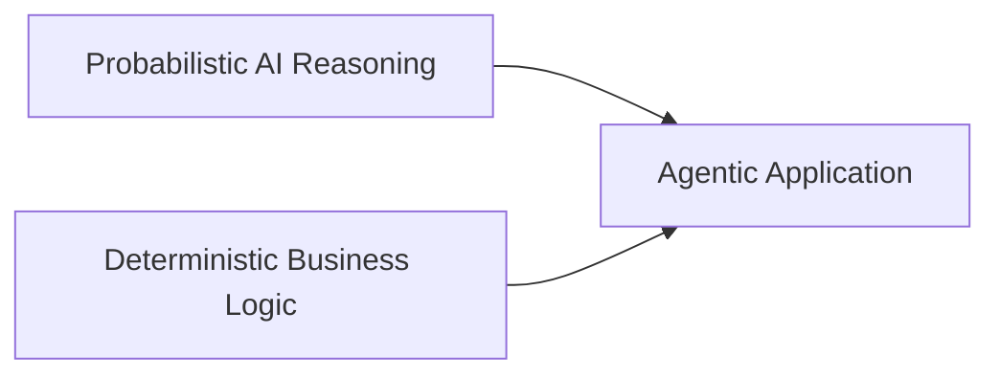

---

title: "Microsoft Agent Framework: Understanding the Architecture"
date: 2026-08-16 13:20:00 +0300
categories: [AI, Microsoft Agent Framework]
tags: [microsoft agent framework, agentic ai, ai agents, dotnet, csharp, software architecture, semantic kernel, autogen]
description: "Understand Microsoft Agent Framework architecture in .NET, from agents and sessions to workflows, middleware, context providers, and the key Agent vs Workflow decision."
media_subpath: /assets/images/ms-agent-framework-architecture/

image:
  path: cover.png
  alt: "Microsoft Agent Framework architecture — agents, workflows, and integrations"

mermaid: true

---

## 🚀 Building an AI agent is becoming surprisingly easy.


Give a language model some instructions, connect it to a few tools, send a request, and let the model reason about what to do next.

Within a relatively small amount of code, we can create something that looks intelligent.

But building an agent is not the difficult part.

The real engineering questions start when that agent becomes part of a production system.

What happens when:

* the agent needs to maintain state across interactions?
* multiple agents or functions need to coordinate?
* execution must follow a specific business process?
* the model needs additional context or enterprise data?
* security, logging, and validation must apply consistently?
* some decisions should remain under application control rather than AI control?

These questions move us beyond simply **building an AI agent**.

They move us toward **engineering an agentic system**.

This is where **Microsoft Agent Framework** becomes particularly interesting.

In this first article of the series, I want to step back from implementation and look at the architecture first:

> **What are the main building blocks of Microsoft Agent Framework, how do they fit together, and where should we use an Agent versus a Workflow?**

---

## Why Microsoft Agent Framework?

Before looking at the architecture, there is an obvious question.

Microsoft already had **Semantic Kernel** and **AutoGen**.

So why another framework?

Microsoft describes Agent Framework as the direct successor to the agent-related work pioneered by both Semantic Kernel and AutoGen.

It combines ideas from the two projects:

* simple abstractions for building single and multi-agent systems,
* session-based state management,
* type safety,
* middleware,
* telemetry,
* broad model support,

and adds an important architectural capability:

**explicit workflows for controlling multi-agent and function execution.**

This is important because an agentic application usually contains two very different types of logic:



An LLM is useful when we need reasoning, interpretation, planning, or dynamic tool selection.

But not every part of a production system should be probabilistic.

Some parts of the system must remain explicit and controlled.

That distinction is one of the ideas that makes Agent Framework interesting from an architecture perspective.


---

## The Main Areas of Microsoft Agent Framework

At a high level, Microsoft currently organizes Agent Framework around four main areas:

* **Agents**
* **Agent Harness**
* **Workflows**
* **Integrations**


Let's look at the big picture first.

This diagram is intentionally high-level.

The important thing to notice is that the framework is not just an abstraction around an LLM.

The model is only one part of the architecture.

Let's break these areas down.

---

## 1. Agents

An agent is the component responsible for using an AI model to perform a task.

It may:

* receive instructions,
* process user input,
* reason about the request,
* call tools,
* use additional context,
* maintain conversational state,
* and generate a response.

In .NET, one of the fundamental abstractions is `AIAgent`.

A common implementation is `ChatClientAgent`, which can operate over an `IChatClient`.

Conceptually:

```text
Application
     ↓
   Agent
     ↓
IChatClient
     ↓
Model Provider
```

The separation between the agent and the model client is important.

The agent represents behavior and execution.

The chat client represents communication with the underlying inference provider.

This means the architecture does not have to be tightly coupled to one specific model provider.

---

## 2. Agent Harness

Microsoft Agent Framework also introduces the concept of an **Agent Harness**.

The idea becomes useful when an agent needs to handle more complex or longer-running work rather than a simple request-response interaction.

Instead of thinking only about:

> Prompt → Model → Response

we may need capabilities around the agent that support more sophisticated execution.

The harness represents a more opinionated environment for composing those capabilities around an agent.

I am intentionally not going deep into Agent Harness in this article because it deserves its own discussion later in the series.

For now, the important point is that Microsoft Agent Framework is thinking beyond a single model call and toward the **runtime environment surrounding an agent**.

---

## 3. Workflows

This is one of the most important parts of the architecture.

An agent is useful when the task is open-ended.

But many real-world systems contain processes where the execution path is already known.

Consider a production release process:

```text
Check deployment
        ↓
Check incidents
        ↓
Analyze risk
        ↓
Request approval
        ↓
Release or stop
```

Do we really want an LLM to decide whether checking active production incidents is necessary?

Probably not.

That is a business process requirement.

This is where **Workflows** become important.

Agent Framework workflows allow developers to connect agents and normal functions through explicit execution paths.

This creates an architecture where AI reasoning can exist **inside** a controlled process.

For example:

```text
Workflow Step
    ↓
Function
    ↓
AI Agent
    ↓
Function
    ↓
Decision
```

The workflow controls **what happens next**.

The agent provides intelligence where intelligence is useful.

This distinction prevents us from turning an entire business process into an uncontrolled autonomous agent.

---

## 4. Integrations

Agents rarely operate in isolation.

A useful agent may need to interact with:

* model providers,
* APIs,
* enterprise systems,
* tools,
* MCP servers,
* context providers,
* evaluation systems,
* user interfaces,
* or external agent services.

Agent Framework groups these capabilities through its integration ecosystem.

Conceptually:

```text
                 Agent
                   |
       ------------------------
       |          |           |
     Models      Tools       MCP
       |          |           |
    Provider    APIs      External
                         Capabilities
```

We will explore tools and MCP separately later because the architectural difference between them is important.

For now, the key idea is:

> **The model reasons, but integrations connect that reasoning to the real system.**

---

## Looking Inside an Agent

The high-level architecture is useful, but the internal agent pipeline is where things become more interesting.

For a .NET `ChatClientAgent`, Microsoft documents a layered execution pipeline.

At a simplified level, the architecture looks like this:


This is much more interesting than:

```text
Prompt → GPT → Response
```

because each layer has a different responsibility.

---

## Agent Middleware

Middleware wraps agent execution.

This makes it a natural place for cross-cutting concerns such as:

* logging,
* validation,
* security checks,
* error handling,
* input transformation,
* output transformation.

The architectural principle here is familiar from traditional software systems.

We do not want every agent implementation repeating:

```text
Log Request
Validate Input
Check Security
Execute Agent
Log Result
```

Instead, middleware allows these concerns to live outside the core agent logic.

The agent can focus on its responsibility.

The surrounding pipeline can enforce system-wide behavior.

---

## Sessions and Conversation History

Agents often need continuity.

Imagine this conversation:

```text
User:
Analyze release 2.4.

Agent:
Release 2.4 has two failed integration tests.

User:
What are the biggest risks?
```

The second message depends on the first one.

Agent Framework supports session-based execution so an agent can maintain the state required across multiple interactions.

But there is an important architecture distinction here.

**Conversation history is not necessarily the same thing as application state.**

And it is not necessarily the same thing as workflow state.

We will come back to that distinction later in the series because it becomes important when designing long-running systems.

---

## Context Providers

Conversation history is only one source of context.

An enterprise agent may also need:

* retrieved documents,
* application data,
* user-specific information,
* memories,
* dynamic instructions,
* domain knowledge.

Context providers allow additional information to be introduced into the execution pipeline.

Conceptually:

```text
Agent Request
      |
      +---- Conversation History
      |
      +---- Retrieved Documents
      |
      +---- Application Context
      |
      +---- Memory
      |
      ↓
     Model
```

This provides a cleaner architectural boundary than hardcoding every source of contextual information directly into the agent.

---

## The Most Important Decision: Agent or Workflow?

One of the strongest ideas in the Microsoft documentation is surprisingly simple:

**not everything should be an agent.**

Microsoft's guidance distinguishes between agents and workflows based on the problem being solved.

An agent is a good fit when:

* the task is open-ended,
* the interaction is conversational,
* autonomous tool selection is useful,
* planning or reasoning is required.

A workflow is a better fit when:

* the process has well-defined steps,
* execution order matters,
* several functions or agents need coordination,
* the application needs explicit control over execution.

Microsoft goes one step further:

> If a normal function can handle the task, use a function instead of an AI agent.

That principle is extremely important.

Agentic architecture should not become:

> “Turn every component into an AI agent.”

It should become:

> **Use probabilistic intelligence only where probabilistic intelligence adds value.**


This diagram may look simple, but it captures an important engineering principle.

The question is not:

> How many agents can we put into this architecture?

The question is:

> **Which decisions actually require AI reasoning?**

---

## Agents and Workflows Are Complementary

Agent versus Workflow should also not be interpreted as a permanent either/or decision for the whole application.

Production architectures can combine both.

For example:

```text
Release Workflow
       |
       +---- Check Deployment      → Function
       |
       +---- Check Incidents       → Function
       |
       +---- Analyze Risk          → AI Agent
       |
       +---- Apply Policy          → Function
       |
       +---- Request Approval      → Controlled Step
```

The workflow defines the process.

The agent is inserted exactly where reasoning adds value.

This is, in my view, a much healthier architecture than allowing one autonomous agent to dynamically control the entire release lifecycle.

It also gives us a useful mental model:

> **Agents provide intelligence. Workflows provide control.**

---

## From Semantic Kernel to Agent Framework

For developers who have worked with Semantic Kernel, some of these concepts will feel familiar.

Semantic Kernel introduced many developers to:

* AI services,
* plugins and functions,
* agents,
* enterprise AI application patterns.

AutoGen explored powerful single-agent and multi-agent interaction patterns.

Agent Framework brings those directions together into a unified architecture while making explicit workflow orchestration a first-class concept.

So I don't think the interesting story is simply:

> “Microsoft created a new SDK.”

The more useful architectural story is:

```text
AI Integration
      ↓
Tool-Enabled Agents
      ↓
Multi-Agent Systems
      ↓
Controlled Agentic Workflows
      ↓
Production Agentic Systems
```

This is also why I want to approach this series differently from a simple “build your first agent” tutorial.

Before writing the implementation, we need to understand the boundaries between the components.

---

## The Architecture We Will Build

Throughout this series, I will use one evolving scenario rather than creating unrelated toy examples.

The project is an:

> **AI Production Release Guardian**

The goal is to explore how AI reasoning can participate safely inside a production release process.

At a very high level:

```text
Release Request
       ↓
Release Workflow
       ↓
System Checks
       ↓
AI Risk Analysis
       ↓
Governed Decision
       ↓
Release / Stop
```

But I am intentionally leaving most of that architecture out of this first article.

As the series progresses, we will add the concepts one at a time.

That will allow us to understand not only **how** Agent Framework APIs work, but **why** each architectural component exists.

---

## What Comes Next?

This article focused on the foundation:

* why Microsoft Agent Framework exists,
* the relationship with Semantic Kernel and AutoGen,
* Agents,
* Agent Harness,
* Workflows,
* Integrations,
* the internal agent pipeline,
* and the Agent vs Workflow decision.

But we have only touched the surface.

In the next articles, we will go deeper into individual architecture decisions and implement them in C#.

### Planned Series

1. **Microsoft Agent Framework: Understanding the Architecture**
   *You are here.*

2. **Agents vs Workflows in Microsoft Agent Framework**
   When should the LLM control execution, and when should the application remain in control?

3. **Building a Tool-Enabled Agent with Microsoft Agent Framework and C#**
   Moving from architecture to our first working implementation.

4. **Building Multi-Agent Workflows with Microsoft Agent Framework**
   Exploring orchestration patterns and coordination between specialized agents.

5. **Human-in-the-Loop: Designing Safe Agentic Workflows**
   Adding governance to decisions that should not be fully autonomous.

6. **Production-Ready Agentic AI: Checkpoints, Middleware and Observability**
   Looking beyond the happy path toward recoverability, monitoring, and operational control.

7. **Semantic Kernel vs Microsoft Agent Framework: What Changed and Why?**
   Comparing the architecture and examining how Microsoft's agent development model is evolving.

---

## Final Thoughts

The easiest way to think about an AI agent is:

```text
LLM + Instructions + Tools
```

But that mental model becomes insufficient very quickly when we move toward production.

A real agentic application may also need:

```text
Agent
  +
Session
  +
Context
  +
Middleware
  +
Tools
  +
Workflow
  +
Application Control
```

And that leads to the key idea I want to carry through this series:

> **The difficult part is no longer building an AI agent. The difficult part is engineering the system around it.**

Microsoft Agent Framework gives us an interesting architecture for exploring exactly that problem.

In the next article, we will take one of the most important design decisions in the framework and examine it in detail:

**Agent or Workflow?**

---

## References

* [Microsoft Agent Framework Overview](https://learn.microsoft.com/en-us/agent-framework/overview/)
* [Agent Pipeline Architecture](https://learn.microsoft.com/en-us/agent-framework/concepts/agents/agent-pipeline)
* [Microsoft Agent Framework Workflows](https://learn.microsoft.com/en-us/agent-framework/workflows/)
* [Agent Middleware](https://learn.microsoft.com/en-us/agent-framework/agents/middleware/)
