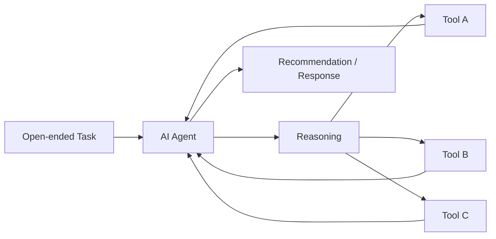
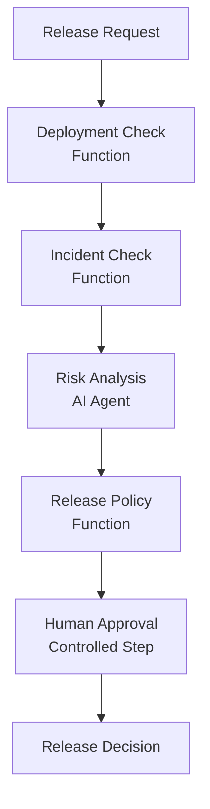

---

title: "Agents vs Workflows in Microsoft Agent Framework: Choosing the Right Abstraction"
date: 2026-08-18 10:00:00 +0300
categories: [AI, Microsoft Agent Framework]
tags: [microsoft agent framework, agentic ai, ai agents, workflows, dotnet, csharp, software architecture, ai engineering]
description: "Learn when to use an Agent, Workflow, or deterministic function in Microsoft Agent Framework, and how to combine them to build controlled production-grade agentic systems."
media_subpath: /assets/images/agent-vs-workflows/

image:
  path: cover.png
  alt: "Agents vs Workflows in Microsoft Agent Framework — choosing the right abstraction"

mermaid: true

---
Building an AI agent is easy.

Deciding **where an agent should exist in your architecture** is much harder.

As agentic AI becomes more accessible, there is a temptation to treat every intelligent-looking requirement as an agent problem:

> **Need validation?** → Create an agent.  
> **Need orchestration?** → Create another agent.  
> **Need to decide what happens next?** → Let the agent decide.

Very quickly, we can end up with an architecture where almost every decision is probabilistic.

That may look impressive in a demo — but it becomes much harder to reason about in production.

One of the design ideas I like most in **Microsoft Agent Framework** is the explicit distinction between:

* deterministic functions,
* AI agents,
* and controlled workflows.


In the previous article, [Microsoft Agent Framework: Understanding the Architecture](/posts/microsoft-agent-framework-architecture/), we explored the overall framework and its main building blocks.
In this article, I want to go deeper into one specific question:

> **When should you use an Agent, and when should you use a Workflow?**

And there is actually one question we should ask before either of those:

> **Do we need AI here at all?**

<div style="border-left: 6px solid #1E88E5; background-color:#EAF4FF; padding:18px 22px; border-radius:8px; margin:28px 0;">

<h2 style="color:#1E88E5; margin-top:0;">🎯 What You'll Learn</h2>

<p>By the end of this article, you'll understand:</p>

<ul>
<li>When deterministic code is enough and an AI agent is unnecessary.</li>
<li>When an open-ended problem is a good fit for an Agent.</li>
<li>When a Workflow is the better abstraction for explicit execution control.</li>
<li>How Agents and Workflows can work together in a production-oriented architecture.</li>
</ul>

</div>

---

## <span style="color:#C0392B;"> Start With the Simplest Question </span>

Before choosing between an Agent and a Workflow, ask:

> **Can normal deterministic code solve this problem reliably?**

If the answer is yes, use a function.

For example:

```text
ValidateEmail()
CalculateDiscount()
CheckPermission()
FormatCurrency()
ApplyReleasePolicy()
```

None of these inherently require reasoning.

They have:

* known inputs,
* known rules,
* predictable outputs.

Introducing an LLM here would usually increase:

* latency,
* cost,
* operational complexity,
* and nondeterminism,

without providing meaningful additional intelligence.

Microsoft's own Agent Framework guidance makes this point explicitly:

> If you can write a function to handle the task, do that instead of using an AI agent.

That is an important principle.

The goal of Agentic AI is not to maximize the number of agents.

The goal is to introduce AI **where intelligence actually adds value**.

---

## <span style="color:#C0392B;"> So When Do We Need an Agent? </span>

Now consider a different type of problem:

> Investigate why this production release may be risky.

There may not be one predefined procedure for answering that question.

The system may need to:

* inspect several signals,
* decide which evidence matters,
* call different tools depending on what it discovers,
* reason across multiple pieces of context,
* and explain its conclusion.

This is a much better fit for an Agent.

Microsoft's current guidance recommends an agent when:

* the task is open-ended or conversational,
* autonomous tool use is useful,
* planning or reasoning is required,
* or a model call with tools can handle the task.

An agent is useful when we intentionally want to give the model some freedom over **how the problem is solved**.

Conceptually:



The exact execution path may differ between requests.

That flexibility is part of the value.

But it is also part of the risk.

---

##  <span style="color:#C0392B;"> Autonomy Is a Design Decision </span>

When we build an agent, we are giving probabilistic software some degree of control.

That does not necessarily mean complete autonomy.

But it may allow the model to decide:

* which tool to call,
* which evidence to investigate,
* which path to explore,
* whether additional information is needed,
* or how to formulate a recommendation.

Those capabilities are extremely valuable for problems that cannot be represented easily as deterministic rules.

But they should be introduced intentionally.

This leads to an important architecture question:

> **Which decisions are allowed to be probabilistic?**

For example, imagine a release system.

Should AI be allowed to decide:

> Which production signals appear suspicious?

Possibly.

Should AI independently decide:

> Whether production incidents should be checked at all?

Probably not.

Checking incidents is part of the process.

That difference is where Workflows become important.

---

## <span style="color:#C0392B;"> What Is a Workflow? </span>

A Workflow represents a controlled execution process.

Microsoft Agent Framework models graph-based workflows through:

* **Executors** — units that perform work,
* **Edges** — connections between executors,
* and a **Workflow** that manages execution and message routing.


The important difference is that the application defines the execution structure.

The LLM does not spontaneously decide:

> Maybe I'll skip the incident check today.

The workflow determines that the step must happen.

Microsoft's documentation recommends workflows when:

* the process has well-defined steps,
* explicit control over execution order is required,
* or multiple agents or functions need to coordinate.

This gives us a useful mental model:

> **Agent = intelligence**

> **Workflow = control**

But that still doesn't tell the whole story.

---

## <span style="color:#C0392B;"> Workflow Does Not Mean “No AI” </span>

A common misunderstanding is that we must choose either:

```text
Agent
```

or:

```text
Workflow
```

for the entire system.

That is not how I think about it.

A Workflow can contain Agents.

And this is where the architecture becomes much more powerful.

Imagine:



Now we have both worlds.

The overall process remains deterministic.

But one specific step contains probabilistic reasoning.

That is a very different architecture from giving one autonomous agent complete ownership of the process.

<div style="border-left: 6px solid #8E44AD; background-color:#F4ECF7; padding:18px 22px; border-radius:8px; margin:28px 0;">

<h2 style="color:#8E44AD; margin-top:0;">🧠 Architecture Insight</h2>

<p>

A Workflow does not remove AI from the architecture.

It defines <strong>where AI is allowed to reason</strong> and where the application must remain in control.

</p>

</div>
---

## <span style="color:#C0392B;"> The Release Guardian Example </span>

Throughout this series, I am building an evolving demo:

> **AI Production Release Guardian**

The goal is not to build another chatbot.

The goal is to explore how AI reasoning can participate inside a controlled production process.

Consider the request:

> Release version 2.4 to production.

There are several things the system may need to do.


### <span style="color:#C0392B;"> Check Deployment Status </span>

We may need to determine:

* whether deployment artifacts exist,
* whether tests passed,
* whether the environment is healthy.

Most of that information can come from deterministic APIs.

So:

```text
GetDeploymentStatus()
```

should probably remain a normal function or workflow executor.

---

### <span style="color:#C0392B;"> Check Production Incidents </span>

We may need:

```text
GetOpenIncidents()
```

Again, this is data retrieval.

There is no reason for an LLM to invent the result.

The function should query the actual system.

---

### <span style="color:#C0392B;"> Analyze Release Risk </span>

Now the problem becomes more interesting.

Imagine the evidence says:

```text
Deployment:
2 integration tests failed

Production:
1 high-severity authentication incident

Changed Components:
Authentication API
Payment API
```

We may want the system to reason:

* Which failures matter most?
* Is there a relationship between the changed component and the open incident?
* What is the likely blast radius?
* What evidence should the release manager pay attention to?
* What additional checks would reduce uncertainty?

That is a much better candidate for an Agent.

---

### <span style="color:#C0392B;"> Apply Release Policy </span>

But after the agent recommends:

```text
Risk: HIGH
```

the organization may have a rule:

```text
HIGH risk → Human approval required
```

Should an LLM decide whether that policy applies?

> **No. Policy enforcement should remain deterministic.**

---
## <span style="color:#C0392B;"> Mapping Each Step to the Right Abstraction </span>

The important point is not the sequence itself.

It is the responsibility assigned to each step.

| Step                               | Best Fit                           |
| ---------------------------------- | ---------------------------------- |
| Retrieve deployment status         | **Function**                       |
| Retrieve production incidents      | **Function**                       |
| Analyze ambiguous risk evidence    | **Agent**                          |
| Apply organizational release rules | **Function**                       |
| Coordinate execution order         | **Workflow**                       |
| High-risk authorization            | **Human-controlled workflow step** |

This is exactly why I don't think **Agent vs Workflow** should be viewed as a framework API choice.

It is an **architecture boundary**.

---
## <span style="color:#C0392B;"> What Happens When We Use an Agent for Everything? </span>

Let's consider the opposite architecture.

Imagine one Release Agent receives:

> **Release version 2.4.**

And we give it these tools:

```text
GetDeploymentStatus()
GetOpenIncidents()
AnalyzeRisk()
DeployRelease()
```

### <span style="color:#C0392B;"> The Agent Now Controls </span>

1. Which tool to call
2. Whether production incidents need checking
3. Whether risk analysis is necessary
4. Whether deployment should proceed

> **The problem:**  
> The agent is no longer responsible only for reasoning.  
> It is now controlling the business process itself.

### What Changes in Production?

| Concern           | Question                                                              |
| ----------------- | --------------------------------------------------------------------- |
| **Reliability**   | What guarantees that required steps always execute?                   |
| **Model Changes** | What happens when behavior changes after a model update?              |
| **Governance**    | How do we prove that release policy was followed?                     |
| **Approval**      | How do we enforce mandatory human approval?                           |
| **Recovery**      | How do we resume execution after an interruption?                     |
| **Auditability**  | How do we distinguish model-driven decisions from policy-driven ones? |


<div style="border-left: 6px solid #F39C12; background-color:#FFF4E5; padding:18px 22px; border-radius:8px; margin:28px 0;">

<h2 style="color:#D68910; margin-top:0;">⚠️ Production Insight</h2>

<p>

The fact that an agent <strong>can</strong> control a process does not mean it <strong>should</strong>.

Capability and responsibility are two different architecture decisions.

</p>

</div>

### <span style="color:#C0392B;"> The Real Architecture Question </span>

> **Can the agent do it?**

is not the same question as:

> **Should the agent be responsible for it?**

That distinction is critical in production systems.

---

## <span style="color:#C0392B;"> Deterministic Outside, Probabilistic Inside </span>

One architectural pattern I find useful is:

> **Keep the process deterministic and put probabilistic reasoning inside carefully selected steps.**

Conceptually:

```text
Deterministic Workflow
        │
        ├── Function
        │
        ├── Function
        │
        ├── AI Agent
        │
        ├── Function
        │
        └── Human Decision
```

The workflow controls the lifecycle.

The agent provides intelligence.

The functions provide reliable operations.

The human provides governance where necessary.

That architecture gives each component a clear responsibility.

---

## <span style="color:#C0392B;"> A Practical Decision Framework </span>

When evaluating a new requirement, I use four simple questions.

### 1. Can Normal Code Solve It?

If the behavior is predictable and the rules are clear:

> **Use a Function.**

**Good fits:** calculations, validation, permission checks, API calls, business rules, and deterministic transformations.

---

### 2. Does the Process Have Known Steps?

If execution order matters and the process must remain explicit and controlled:

> **Use a Workflow.**

**Good fits:** approval processes, deployment pipelines, onboarding flows, compliance checks, and multi-step business processes.

---

### 3. Is the Problem Open-Ended?

If the system needs to interpret information, investigate, reason, plan, or dynamically select tools:

> **Use an Agent.**

**Good fits:** incident investigation, risk analysis, research, adaptive troubleshooting, and complex recommendations.

---

### 4. Does the Process Need Both?

In many production systems, the answer is:

> **Use Agents inside a Workflow.**

The workflow controls the process.

The agent adds reasoning only where reasoning is actually needed.

### <span style="color:#C0392B;"> Quick Decision Guide </span>

| Requirement                                   | Best Fit                  |
| --------------------------------------------- | ------------------------- |
| Clear rules and predictable output            | **Function**              |
| Known steps and controlled execution          | **Workflow**              |
| Open-ended reasoning or dynamic decisions     | **Agent**                 |
| Controlled process with selected AI reasoning | **Agent inside Workflow** |

> **The goal is not to choose the most intelligent abstraction. The goal is to choose the simplest abstraction that reliably solves the problem.**

<div style="border-left: 6px solid #2E7D32; background-color:#E8F5E9; padding:18px 22px; border-radius:8px; margin:28px 0;">

<h2 style="color:#2E7D32; margin-top:0;">✅ Decision Rule</h2>

<p>

Start with the <strong>least autonomous abstraction</strong> that can solve the problem reliably.

Move from <strong>Function → Workflow → Agent</strong> only when the requirement genuinely needs more reasoning or flexibility.

</p>

</div>
---

## <span style="color:#C0392B;"> Agent vs Workflow Is Really About Control </span>

I think the most useful way to frame the decision is not:

> Agent API vs Workflow API.

Instead, ask:

> **Who controls the execution?**


With an **Agent**, we intentionally delegate part of the execution path to the AI model.

With a **Workflow**, the application explicitly defines the execution structure.

Neither approach is inherently better.

They solve different problems.

The real engineering challenge is deciding **where each form of control belongs**.

---

## <span style="color:#C0392B;"> What About Multi-Agent Systems? </span>

There is another temptation in Agentic AI:

> If one agent is useful, multiple agents must be better.

Not necessarily.

Microsoft Agent Framework provides multiple orchestration patterns, including:

* Sequential,
* Concurrent,
* Handoff,
* Group Chat,
* Magentic.

But the existence of an orchestration pattern does not mean every problem requires multiple agents.

Before building a multi-agent system, we should still ask:

> Would one agent with good tools solve this?

If yes, start there.

If specialized agents genuinely require different responsibilities, contexts, tools, or independent perspectives, multi-agent orchestration may add value.

We will explore that decision in a later article.

---

## <span style="color:#C0392B;"> Where Workflows Become Even More Important </span>

Workflow control becomes particularly valuable once production requirements appear.

For example:

* human approval,
* long-running execution,
* recovery,
* checkpointing,
* workflow state,
* observability.

Microsoft Agent Framework workflows include capabilities for pausing for external input, restoring execution from checkpoints, and exporting workflow telemetry.

We will not go deep into those capabilities here.

They deserve their own article.

But they reinforce an important idea:

> A production agentic system is not only about reasoning.

It is also about **control, durability, governance, and operations**.

---

## <span style="color:#C0392B;"> The Architecture Principle </span>

If there is one principle I would take from this architecture, it is:

> **Use probabilistic intelligence only where it adds value. Keep everything else deterministic.**

A strong agentic system is not the one that delegates the most control to AI.

It is the one that makes the boundary between **deterministic software** and **probabilistic reasoning** explicit.

---
## <span style="color:#C0392B;"> What We Will Build Next  </span>

The first two articles established the architecture before touching the implementation.

| Part       | Focus                                  | Key Question                                                                        |
| ---------- | -------------------------------------- | ----------------------------------------------------------------------------------- |
| **Part 1** | Microsoft Agent Framework Architecture | What are the main building blocks and how do they fit together?                     |
| **Part 2** | Agents vs Workflows                    | Where should probabilistic reasoning end and deterministic control begin?           |
| **Part 3** | Tools + C# Implementation              | How does an agent interact with real systems instead of relying only on its prompt? |

Now it is time to move from **architecture to implementation**.

### <span style="color:#C0392B;"> Next: Building a Tool-Enabled Agent with C# </span>

In the next article, we will start implementing the **AI Production Release Guardian** using Microsoft Agent Framework and C#.

Instead of asking the model to guess what is happening in production, we will give the agent access to real capabilities such as:

* deployment status,
* production incidents,
* release information,
* and other operational signals.

This introduces the next fundamental building block of an agentic system:

> **Tools turn reasoning into action grounded in real system data.**

And that is where our Release Guardian starts becoming more than an architecture diagram.


---
## <span style="color:#C0392B;"> Final Thoughts </span>

The strongest agentic architecture is not the one with the most agents.

It is the one that gives each component a clear responsibility:

- **Functions** for deterministic logic
- **Workflows** for execution control
- **Agents** for reasoning where uncertainty exists
- **Humans** for decisions that require governance

The important question is never:

> **How much control can we give the LLM?**

It is:

> **Where does probabilistic intelligence genuinely add value?**

Production Agentic AI should not mean giving the model control of everything.

It should mean designing explicit boundaries between **deterministic software**, **AI reasoning**, and **human governance**.

That boundary is not a limitation.

It is part of the architecture.
---

## <span style="color:#C0392B;"> References </span>

* [Microsoft Agent Framework Overview](https://learn.microsoft.com/en-us/agent-framework/overview/)
* [Microsoft Agent Framework Workflows](https://learn.microsoft.com/en-us/agent-framework/workflows/)
* [Workflow Builder & Execution](https://learn.microsoft.com/en-us/agent-framework/concepts/workflows/builder-and-execution)
* [Agents in Workflows](https://learn.microsoft.com/en-us/agent-framework/workflows/agents-in-workflows)
