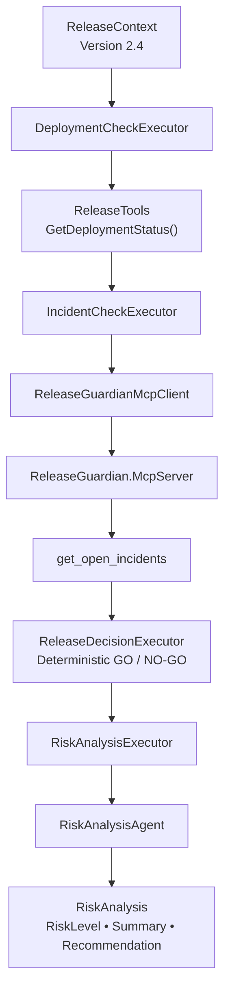

## <span style="color:#C0392B;"> Connecting Microsoft Agent Framework to Real Systems with C# and MCP </span>

In the previous article, [Agents vs Workflows in Microsoft Agent Framework](/posts/agents-vs-workflows-microsoft-agent-framework/), we established a clear boundary:

> **Deterministic software owns facts and policy. AI owns reasoning where reasoning adds value.**

Now we will implement that boundary.

For the **AI Production Release Guardian**, the system needs current operational evidence before any meaningful risk analysis can happen.

For Release 2.4, that evidence includes:

```text
Deployment Status
Integration Test Results
Security Scan Status
Open Production Incidents
Incident Severity
Affected Service
```

The LLM should not generate any of this information.

Instead, the Release Guardian retrieves it from the systems that own it:

```text
Deployment Evidence
        ↓
C# Application Function

Production Incidents
        ↓
MCP Tool
```

The collected evidence is then passed to the AI agent for:

```text
RiskLevel
Summary
Recommendation
```

So the architecture for this article is simple:

> **Retrieve trusted evidence → apply deterministic policy → use AI to analyze the evidence.**

We will implement this using **C#**, **Microsoft Agent Framework**, and **Model Context Protocol (MCP)**.

---
<div style="border-left: 6px solid #1E88E5; background-color:#EAF4FF; padding:18px 22px; border-radius:8px; margin:28px 0;">

<h2 style="color:#1E88E5; margin-top:0;">🎯 What You'll Learn</h2>

<ul>
<li>How the Release Guardian retrieves deployment evidence through deterministic C# code.</li>
<li>How production incident data is exposed and consumed through Model Context Protocol (MCP).</li>
<li>How both sources are collected into a shared <code>ReleaseContext</code>.</li>
<li>How the AI agent receives that evidence and produces a structured risk analysis without owning release policy.</li>
</ul>

</div>

---

## <span style="color:#C0392B;"> The Architecture for This Step </span>

For this part of the series, we are focusing on one specific boundary:

> **How does the Release Guardian collect real operational evidence before asking AI to reason about it?**

The workflow starts with a `ReleaseContext` for Release 2.4.

Deployment information is retrieved through normal C# application code, while production incident information comes from a separate capability exposed through MCP.

Only after that evidence has been collected does the workflow apply deterministic release policy and pass the result to the AI risk analysis layer.



The important point is not simply that these components use different technologies.

They have different responsibilities:

```text
C# Function
    ↓
Retrieves application-owned deployment facts

MCP
    ↓
Exposes production incident data through a separate MCP capability

Deterministic Code
    ↓
Applies release policy and produces GO / NO-GO

AI Agent
    ↓
Interprets the collected evidence and produces risk analysis
```

The workflow therefore separates four concerns:

* **Operational facts** come from the systems that own them.
* **Integration boundaries** are handled through application code or MCP.
* **Release policy** remains deterministic.
* **AI reasoning** is used only after the evidence is available.

---
<div style="border-left: 6px solid #8E44AD; background-color:#F4ECF7; padding:18px 22px; border-radius:8px; margin:28px 0;">

<h2 style="color:#8E44AD; margin-top:0;">🧠 Architecture Insight</h2>

<p>

<strong>Facts should come from the systems that own them.</strong>

The model can reason about those facts, but it should not be responsible for inventing them or enforcing deterministic release policy.

</p>

</div>
---
## <span style="color:#C0392B;"> Source #1: Deployment Evidence from Deterministic C# Code </span>

The first source of evidence is the deployment status.

In the current Release Guardian implementation, this information is provided by a normal C# method:

```csharp
public static class ReleaseTools
{
    [Description(
        "Gets release readiness information including tests, deployment environment and security scan status. " +
        "Do not use this for production incidents.")]
    public static DeploymentStatus GetDeploymentStatus()
    {
        Console.WriteLine("TOOL CALLED: GetDeploymentStatus");

        return new DeploymentStatus
        {
            Version = "2.4",
            Environment = "Staging",
            UnitTestsPassed = true,
            FailedIntegrationTests = 1,
            SecurityScanPassed = true
        };
    }
}
```

For the demo, the method returns fixed operational data so that we can focus on the architecture.

In a production implementation, the same boundary could retrieve deployment evidence from Azure DevOps, GitHub Actions, a deployment API, or another CI/CD system.

The important point is that this capability remains **deterministic application code**.

The workflow invokes it through `DeploymentCheckExecutor`:

```csharp
public override ValueTask<ReleaseContext> HandleAsync(
    ReleaseContext message,
    IWorkflowContext context,
    CancellationToken cancellationToken = default)
{
    Console.WriteLine("WORKFLOW: Checking deployment status...");

    message.DeploymentStatus =
        ReleaseTools.GetDeploymentStatus();

    return ValueTask.FromResult(message);
}
```

The result is then stored in the shared `ReleaseContext` and becomes part of the evidence used later in the release assessment.

At this stage, no AI reasoning is required.

The workflow is simply collecting a fact that can be obtained deterministically.

---
## <span style="color:#C0392B;"> Source #2: Production Incident Evidence Through MCP </span>

The second source of evidence is production incident information.

Unlike deployment status, this capability is exposed through **Model Context Protocol (MCP)**.

In the Release Guardian solution, a separate MCP server defines the `get_open_incidents` tool:


```csharp
[McpServerToolType]
public static class ReleaseOperationsTools
{
    [McpServerTool(
        Name = "get_open_incidents"),
     Description(
        "Gets currently active production incidents " +
        "including severity, affected service and status.")]
    public static object GetOpenIncidents()
    {
        return new
        {
            OpenIncidents = 1,
            Severity = "High",
            Service = "Authentication API",
            Status = "Investigating"
        };
    }
}
```

For the demo, the MCP tool returns fixed incident data.

In a production system, the same MCP boundary could expose data from an incident-management platform, monitoring service, or internal operations API.

The MCP server is configured to communicate over **stdio**:

```csharp
builder.Services
    .AddMcpServer()
    .WithStdioServerTransport()
    .WithToolsFromAssembly();
```

On the application side, `ReleaseGuardianMcpClient` connects to the MCP server and invokes the tool by name:

```csharp
CallToolResult result =
    await client.CallToolAsync(
        "get_open_incidents",
        new Dictionary<string, object?>(),
        cancellationToken: cancellationToken);
```

The returned MCP content is then deserialized into the application's `IncidentInfo` model:

```csharp
IncidentInfo? incidentInfo =
    JsonSerializer.Deserialize<IncidentInfo>(
        json,
        new JsonSerializerOptions
        {
            PropertyNameCaseInsensitive = true
        });
```

The execution path is therefore:

```text
IncidentCheckExecutor
        ↓
ReleaseGuardianMcpClient
        ↓
Stdio Transport
        ↓
ReleaseGuardian.McpServer
        ↓
MCP Tool: get_open_incidents
        ↓
IncidentInfo
```

`IncidentCheckExecutor` does not need to know how the MCP server implements the capability.

It only consumes the result:

```csharp
IncidentInfo incidents =
    await ReleaseGuardianMcpClient
        .GetOpenIncidentsAsync(cancellationToken);

message.IncidentInfo = incidents;
```

The incident evidence is then added to the same `ReleaseContext` that already contains the deployment evidence.

At this point, we have collected operational data from two different integration boundaries:

```text
Deployment Evidence → Deterministic C# Code
Incident Evidence   → MCP
```

The AI still has not made any release decision or generated any operational facts.

Its role comes later, after the evidence has been collected.

---
## <span style="color:#C0392B;"> One Shared Context, Multiple Sources of Evidence </span>

The deployment and incident results are carried through the workflow using a shared `ReleaseContext`.

At this stage, the relevant part of the context is:

```csharp
public class ReleaseContext
{
    public string Version { get; set; } = string.Empty;

    public DeploymentStatus? DeploymentStatus { get; set; }

    public IncidentInfo? IncidentInfo { get; set; }
}
```

As each executor completes, it enriches the same workflow context with new evidence:

```text
ReleaseContext
      │
      ├── Version: 2.4
      │
      ├── DeploymentStatus
      │      ├── Unit Tests
      │      ├── Integration Tests
      │      ├── Security Scan
      │      └── Environment
      │
      └── IncidentInfo
             ├── Open Incidents
             ├── Severity
             ├── Affected Service
             └── Status
```

This gives the workflow one shared state containing evidence collected from two different integration boundaries:

```text
Deployment Evidence → Deterministic C# Code
Incident Evidence   → MCP
```

No AI reasoning has been required to collect either source.

The workflow now has the facts it needs.

The next step is deciding what those facts mean for the release.

---
## <span style="color:#C0392B;"> Deterministic Policy Still Comes First </span>

Once the operational evidence has been collected, the workflow evaluates the release against explicit business rules.

This responsibility belongs to `ReleaseDecisionExecutor`.

For example, failed integration tests immediately produce a deterministic `NO-GO` decision:

```csharp
if (message.DeploymentStatus.FailedIntegrationTests > 0)
{
    message.CanDeploy = false;

    message.DecisionReason =
        $"Deployment blocked because " +
        $"{message.DeploymentStatus.FailedIntegrationTests} integration tests failed.";

    return ValueTask.FromResult(message);
}
```

The same principle applies to active high-severity production incidents:

```csharp
if (message.IncidentInfo.OpenIncidents > 0 &&
    (message.IncidentInfo.Severity.Equals(
         "High",
         StringComparison.OrdinalIgnoreCase) ||
     message.IncidentInfo.Severity.Equals(
         "Critical",
         StringComparison.OrdinalIgnoreCase)))
{
    message.CanDeploy = false;

    message.DecisionReason =
        $"Deployment blocked because there is an active " +
        $"{message.IncidentInfo.Severity} severity production incident.";

    return ValueTask.FromResult(message);
}
```

These rules are not expressed as prompts.

They are application policy implemented directly in code.

```text
Operational Evidence
        ↓
ReleaseDecisionExecutor
        ↓
Explicit Rules
        ↓
GO / NO-GO
```

The model does not decide whether a failed integration test should be ignored.

It does not reinterpret a `High` or `Critical` production incident as acceptable.

Those decisions remain deterministic.

The AI receives the result later as part of the evidence it analyzes.

<div style="border-left: 6px solid #2E7D32; background-color:#E8F5E9; padding:18px 22px; border-radius:8px; margin:28px 0;">

<h2 style="color:#2E7D32; margin-top:0;">✅ Design Principle</h2>

<p>

<strong>Use deterministic code to enforce release policy.</strong>

Use the AI agent to analyze context, explain risk, identify relationships, and describe potential production impact.

</p>

</div>
---
## <span style="color:#C0392B;"> AI Receives the Collected Evidence </span>

At this point, the workflow has already completed two responsibilities:

1. collecting operational evidence,
2. applying the deterministic release policy.

Only then does `RiskAnalysisExecutor` invoke the `RiskAnalysisAgent`.

The executor builds the agent input directly from the current `ReleaseContext`:

```csharp
string prompt = $"""
    Analyze the following software release.

    Version:
    {message.Version}

    Failed Integration Tests:
    {message.DeploymentStatus?.FailedIntegrationTests}

    Unit Tests Passed:
    {message.DeploymentStatus?.UnitTestsPassed}

    Security Scan Passed:
    {message.DeploymentStatus?.SecurityScanPassed}

    Open Production Incidents:
    {message.IncidentInfo?.OpenIncidents}

    Incident Severity:
    {message.IncidentInfo?.Severity}

    Affected Service:
    {message.IncidentInfo?.Service}

    Incident Status:
    {message.IncidentInfo?.Status}

    Deterministic Release Decision:
    {(message.CanDeploy ? "GO" : "NO-GO")}

    Decision Reason:
    {message.DecisionReason}

    Explain:
    1. Overall risk level
    2. Main technical risks
    3. Potential production impact
    4. Recommendation to the release manager
    """;
```

Notice that the agent receives both the operational evidence and the deterministic release decision.

It is not being asked to discover whether tests failed or whether an incident exists.

Those facts have already been collected.

It is being asked to interpret what those facts mean from a risk perspective.

The agent is invoked with a typed response:

```csharp
AgentResponse<RiskAnalysis> response =
    await _agent.RunAsync<RiskAnalysis>(
        prompt,
        cancellationToken: cancellationToken);

message.RiskAnalysis = response.Result;
```

The result is mapped into a small domain model:

```csharp
public class RiskAnalysis
{
    public string RiskLevel { get; set; } = string.Empty;

    public string Summary { get; set; } = string.Empty;

    public string Recommendation { get; set; } = string.Empty;
}
```

This creates a clear responsibility boundary:

```text
Operational Systems
        ↓
Facts

Deterministic Code
        ↓
GO / NO-GO Policy

AI Agent
        ↓
RiskLevel
Summary
Recommendation
```

The AI is responsible for:

```text
Risk interpretation
Technical impact analysis
Contextual relationships
Recommendation
```

It is not responsible for:

```text
Test results
Incident data
Deterministic GO / NO-GO policy
Final deployment authorization
```

This is the practical implementation of the architecture principle from the previous article:

> **Deterministic software controls what must be true. AI reasons about what the evidence may mean.**

---

## <span style="color:#C0392B;"> Runtime Execution Trace </span>

The runtime output makes these boundaries visible.


A real execution starts by collecting deployment evidence:

So the runtime sequence matches the architecture:

```text
Deployment Evidence
        ↓
Production Incident Evidence
        ↓
Deterministic Release Policy
        ↓
AI Risk Analysis
```

The model participates only after the workflow has established the operational facts and policy outcome.

This keeps AI reasoning inside a controlled execution process rather than making the model responsible for the entire release lifecycle.<div style="border-left: 6px solid #F39C12; background-color:#FFF4E5; padding:18px 22px; border-radius:8px; margin:28px 0;">

<h2 style="color:#D68910; margin-top:0;">⚠️ Production Insight</h2>

<p>

Connecting AI to operational capabilities does not mean transferring control of the system to the model.

A production-oriented architecture keeps clear boundaries between <strong>evidence retrieval, policy enforcement, AI reasoning, and authorization</strong>.

</p>

</div>

---

## <span style="color:#C0392B;"> What We Added in Part 3 </span>

At this stage, the Release Guardian has clearly separated responsibilities:

| Responsibility               | Implementation            |
| ---------------------------- | ------------------------- |
| Deployment evidence          | Deterministic C# code     |
| Production incident evidence | MCP tool                  |
| Shared workflow state        | `ReleaseContext`          |
| Release policy               | `ReleaseDecisionExecutor` |
| Contextual risk analysis     | `RiskAnalysisAgent`       |

The resulting execution model is:

```text
Operational Evidence
        ↓
Shared ReleaseContext
        ↓
Deterministic Policy
        ↓
AI Risk Analysis
```

This gives the AI access to the information it needs without making it responsible for producing operational facts or controlling release policy.

The next challenge is orchestration.

---

## <span style="color:#C0392B;"> Next: Building Agentic Workflows </span>

So far, we have focused on the responsibilities of the individual components.

In Part 4, we will open `ReleaseWorkflow.cs` and examine how Microsoft Agent Framework coordinates those components as one controlled execution graph.

We will look at:

- Executors
- Edges
- Conditional routing
- Shared workflow state
- Deterministic and AI-driven steps
- Multiple execution paths

We will also examine where orchestration patterns such as **Sequential**, **Concurrent**, and **Handoff** fit, and when multiple specialized agents are actually justified.

The question now changes from:

> **How does AI get access to real system evidence?**

to:

> **How do we coordinate deterministic software and AI reasoning inside one controlled agentic workflow?**

---

## <span style="color:#C0392B;"> Final Thoughts </span>

Connecting an AI model to production systems is not primarily about giving the model more autonomy.

It is about giving it access to the right evidence while preserving clear architectural boundaries.

For the Release Guardian:

```text
Deployment Evidence  → C#
Incident Evidence    → MCP
Release Policy       → Deterministic Code
Risk Interpretation  → AI
```

Each component owns a different responsibility.

The model does not invent deployment state.

It does not create production incidents.

It does not redefine release policy.

It receives trusted evidence and reasons over it.

That leads to the principle I want to carry into the next part of the series:

> **Connect AI to the evidence it needs, but keep control where control belongs.**
---

## <span style="color:#C0392B;"> References </span>

* [Microsoft Agent Framework Overview](https://learn.microsoft.com/en-us/agent-framework/overview/)
* [Microsoft Agent Framework Workflows](https://learn.microsoft.com/en-us/agent-framework/workflows/)
* [Model Context Protocol C# SDK](https://github.com/modelcontextprotocol/csharp-sdk)
