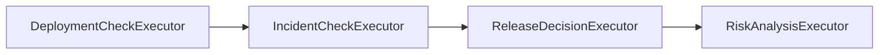
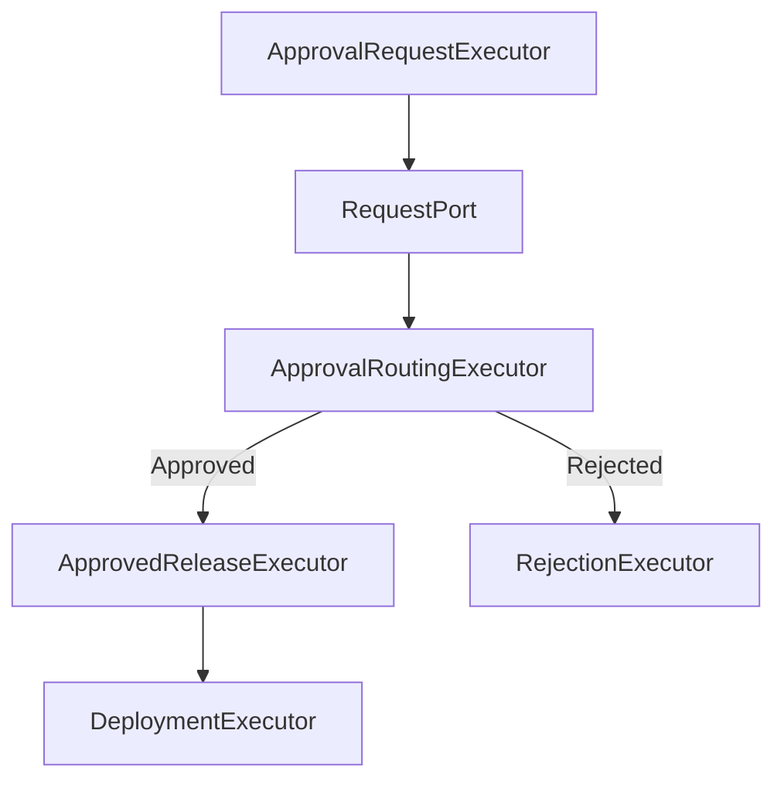

---

title: "Building Agentic Workflows with Microsoft Agent Framework and C#: Executors, Edges and Conditional Routing"
date: 2026-08-24 15:26:00 +0300
categories: [AI, Microsoft Agent Framework]
tags: [microsoft agent framework, agentic ai, ai agents, workflows, orchestration, dotnet, csharp, executors, conditional routing, ai engineering]
description: "Build controlled agentic workflows with Microsoft Agent Framework and C# using executors, edges, shared state, conditional routing, AI reasoning, and multiple execution paths."
media_subpath: /assets/images/ms-agent-framework-post4/

image:
path: cover.png
alt: "Building agentic workflows with Microsoft Agent Framework using executors, edges, and conditional routing"

mermaid: true

---

## <span style="color:#C0392B;"> From AI Components to an Executing System </span>

In the previous article, [Tools and MCP in Microsoft Agent Framework: Connecting AI to Real Systems with C#](/posts/tools-mcp-microsoft-agent-framework-csharp/), we connected our Release Guardian to real operational capabilities.

The system can now retrieve:

```text

Deployment Evidence → Deterministic C# Code
Production Incidents → MCP

```

It can apply release policy through deterministic code.

And it can pass the collected evidence to an AI agent for contextual risk analysis.

But having all of those components does not automatically give us a production workflow.

Something still needs to answer:

> **What runs first?**

> **What runs next?**

> **Which steps are mandatory?**

> **What happens when the result changes?**

> **Which path should execution follow?**

> **Where is AI allowed to reason, and where must the application remain in control?**

That is the problem of **orchestration**.

In this article, we will open the `ReleaseWorkflow.cs` implementation and examine how Microsoft Agent Framework coordinates deterministic software, MCP integration, AI reasoning, security controls, and multiple execution paths inside one controlled workflow.

---

<div style="border-left: 6px solid #1E88E5; background-color:#EAF4FF; padding:18px 22px; border-radius:8px; margin:28px 0;">

<h2 style="color:#1E88E5; margin-top:0;">🎯 What You'll Learn</h2>

<p>By the end of this article, you'll understand:</p>

<ul>
<li>How Microsoft Agent Framework models execution as a workflow graph.</li>
<li>How Executors represent individual units of work.</li>
<li>How Edges make execution order explicit.</li>
<li>How conditional edges implement controlled routing.</li>
<li>How a shared <code>ReleaseContext</code> evolves across the workflow.</li>
<li>How deterministic code, MCP integration, AI reasoning, and human-controlled steps can coexist inside one workflow.</li>
<li>Why a workflow with many Executors is not automatically a multi-agent system.</li>
</ul>

</div>

---

> 💻 **Source Code**
>
> The complete **AI Production Release Guardian** implementation used in this series is available on GitHub:
>
> [AI Production Release Guardian](https://github.com/hodaUsama/AI-Production-Release-Guardian)

---

## <span style="color:#C0392B;"> The Architecture We Already Have </span>

Before building the workflow graph, let's recap the responsibilities already implemented in the Release Guardian.

For Release 2.4, the system currently contains:

```text
Deployment Status
      ↓
Deterministic C# Tool

Production Incidents
      ↓
MCP

Release Policy
      ↓
Deterministic Code

Risk Interpretation
      ↓
AI Agent
```

Each component already knows how to perform its own responsibility.

But none of them should independently decide the lifecycle of the release.

For example:

`DeploymentCheckExecutor` should retrieve deployment evidence.

It should not decide whether the next step is incident analysis.

`RiskAnalysisAgent` should analyze technical risk.

It should not decide whether required operational checks may be skipped.

`DeploymentExecutor` should deploy the release.

It should not decide whether approval was required.

The workflow owns that coordination.

This gives us another important separation:

```text
Component
    ↓
Knows how to perform work

Workflow
    ↓
Knows how work is coordinated
```

---

## <span style="color:#C0392B;"> A Workflow Is an Execution Graph </span>

The Release Guardian workflow is built using `WorkflowBuilder`.

The starting executor is the deployment check:

```csharp
WorkflowBuilder builder =
    new(deploymentCheck);
```

From there, we explicitly connect the first stages:

```csharp
builder
    .AddEdge(
        deploymentCheck,
        incidentCheck)

    .AddEdge(
        incidentCheck,
        decision)

    .AddEdge(
        decision,
        riskAnalysis);
```

Conceptually:



This graph is much more than a visual representation.

It defines execution control.

The model does not dynamically decide:

> Maybe I should check incidents before deployment status.

And it cannot decide:

> I already have enough information, so I will skip release policy.

The application has explicitly defined the order:

```text
Deployment Evidence
        ↓
Production Incident Evidence
        ↓
Deterministic Release Policy
        ↓
AI Risk Analysis
```

This is the practical implementation of the architecture principle we introduced earlier in the series:

> **Agents provide intelligence. Workflows provide control.**

---

<div style="border-left: 6px solid #8E44AD; background-color:#F4ECF7; padding:18px 22px; border-radius:8px; margin:28px 0;">

<h2 style="color:#8E44AD; margin-top:0;">🧠 Architecture Insight</h2>

<p>

A workflow does not exist because the individual components are incapable of executing themselves.

It exists because a production system needs an explicit answer to:

<strong>Who controls what happens next?</strong>

</p>

</div>

---

## <span style="color:#C0392B;"> Executors: One Abstraction, Different Responsibilities </span>

A useful detail in the Release Guardian is that many workflow nodes are implemented as Executors.

But they do not all perform the same type of work.

Consider the first four.

### DeploymentCheckExecutor

```csharp
public sealed class DeploymentCheckExecutor
    : Executor<ReleaseContext, ReleaseContext>
{
    public override ValueTask<ReleaseContext> HandleAsync(
        ReleaseContext message,
        IWorkflowContext context,
        CancellationToken cancellationToken = default)
    {
        Console.WriteLine(
            "WORKFLOW: Checking deployment status...");

        message.DeploymentStatus =
            ReleaseTools.GetDeploymentStatus();

        return ValueTask.FromResult(message);
    }
}
```

This Executor invokes deterministic application code.

Its responsibility is:

> **Retrieve deployment facts.**

---

### IncidentCheckExecutor

The next Executor retrieves production incident data through MCP:

```csharp
IncidentInfo incidents =
    await ReleaseGuardianMcpClient
        .GetOpenIncidentsAsync(cancellationToken);

message.IncidentInfo = incidents;
```

Its responsibility is different:

> **Integrate with an external operational capability.**

---

### ReleaseDecisionExecutor

Next, deterministic business policy is applied.

For example:

```csharp
if (message.DeploymentStatus.FailedIntegrationTests > 0)
{
    message.CanDeploy = false;

    message.DecisionReason =
        $"Deployment blocked because " +
        $"{message.DeploymentStatus.FailedIntegrationTests} integration tests failed.";

    return ValueTask.FromResult(message);
}
```

Its responsibility is:

> **Enforce release policy.**

There is no AI reasoning here.

A failed required integration test remains a failed integration test regardless of what the model thinks about it.

---

### RiskAnalysisExecutor

Only after facts have been retrieved and policy evaluated do we invoke the AI layer.

`RiskAnalysisExecutor` receives an `AIAgent`:

```csharp
public sealed class RiskAnalysisExecutor
    : Executor<ReleaseContext, ReleaseContext>
{
    private readonly AIAgent _agent;

    public RiskAnalysisExecutor(AIAgent agent)
        : base("RiskAnalysisExecutor")
    {
        _agent = agent;
    }
}
```

The Executor then invokes the agent using the evidence already available in `ReleaseContext`.

Its responsibility is:

> **Interpret risk using AI reasoning.**

So even though these components participate in the same Workflow, their architectural roles are different.

| Executor                  | Responsibility                 | Nature        |
| ------------------------- | ------------------------------ | ------------- |
| `DeploymentCheckExecutor` | Retrieve deployment evidence   | Deterministic |
| `IncidentCheckExecutor`   | Retrieve incidents through MCP | Integration   |
| `ReleaseDecisionExecutor` | Apply release policy           | Deterministic |
| `RiskAnalysisExecutor`    | Interpret release risk         | AI reasoning  |

This is an important point.

> **Workflow orchestration does not require pretending that every step is an AI agent.**

---

## <span style="color:#C0392B;"> The Shared ReleaseContext </span>

As execution moves through the graph, the Executors operate on a shared application context.

The current implementation contains:

```csharp
public class ReleaseContext
{
    public string Version { get; set; } = string.Empty;

    public DeploymentStatus? DeploymentStatus { get; set; }

    public IncidentInfo? IncidentInfo { get; set; }

    public bool CanDeploy { get; set; }

    public string DecisionReason { get; set; } = string.Empty;

    public RiskAnalysis? RiskAnalysis { get; set; }

    public bool IsSecurityBlocked { get; set; }

    public string SecurityBlockReason { get; set; } = string.Empty;
}
```

The context starts small.

For example:

```text
ReleaseContext

Version = 2.4
```

After the deployment check:

```text
ReleaseContext
    │
    ├── Version
    └── DeploymentStatus
```

After the incident check:

```text
ReleaseContext
    │
    ├── Version
    ├── DeploymentStatus
    └── IncidentInfo
```

After deterministic policy:

```text
ReleaseContext
    │
    ├── Version
    ├── DeploymentStatus
    ├── IncidentInfo
    ├── CanDeploy
    └── DecisionReason
```

And after AI risk analysis:

```text
ReleaseContext
    │
    ├── Version
    ├── DeploymentStatus
    ├── IncidentInfo
    ├── CanDeploy
    ├── DecisionReason
    └── RiskAnalysis
```

This creates a simple execution model:

```text
Read Current Context
        ↓
Perform One Responsibility
        ↓
Enrich Context
        ↓
Pass It Forward
```

The workflow therefore does not need every component to independently reconstruct the release state.

Each step receives the evidence collected so far and contributes its own result.

---

## <span style="color:#C0392B;"> Edges Make Execution Explicit </span>

The first part of the workflow is sequential:

```text
DeploymentCheck
      ↓
IncidentCheck
      ↓
ReleaseDecision
      ↓
RiskAnalysis
```

For those steps, normal edges are enough.

But production processes are rarely one straight line.

After risk analysis, the Release Guardian may need to do very different things.

A release may be:

* safe enough to deploy,
* high-risk and require human approval,
* or blocked by a security guardrail.

This is where conditional routing becomes important.

---

## <span style="color:#C0392B;"> Conditional Routing After AI Analysis </span>

After `RiskAnalysisExecutor` completes, the workflow defines three possible routes.


The important detail is that the routing itself remains explicit application logic.

Let's examine each branch.

---

## <span style="color:#C0392B;"> Path 1: Security Violation → Stop </span>

The first conditional edge handles a security guardrail failure:

```csharp
builder.AddEdge<ReleaseContext>(
    riskAnalysis,
    securityBlock,
    message =>
        message.IsSecurityBlocked);
```

If the AI execution was blocked by the security guardrail, the workflow does not ask the model what should happen.

It routes execution directly to `SecurityBlockExecutor`.

That Executor makes the outcome clear:

```text
SECURITY BLOCK
```

and explicitly states that human override is not allowed for this type of failure.

Architecturally:

```text
Security Guardrail Failure
          ↓
Explicit Workflow Route
          ↓
Hard Stop
```

This is different from normal release risk.

A high-risk release may require governance.

A security violation may represent a boundary that the workflow does not allow anyone to bypass.

---

<div style="border-left: 6px solid #F39C12; background-color:#FFF4E5; padding:18px 22px; border-radius:8px; margin:28px 0;">

<h2 style="color:#D68910; margin-top:0;">⚠️ Production Insight</h2>

<p>

Not every branch should be delegated to an AI model.

If the routing rule represents a deterministic security or policy boundary, encode that boundary directly in the workflow.

</p>

</div>

---

## <span style="color:#C0392B;"> Path 2: Safe Release → Deploy Directly </span>

The second route handles a release that:

* is not security blocked,
* passes deterministic release policy,
* and is not classified as High or Critical risk.

The edge is:

```csharp
builder.AddEdge<ReleaseContext>(
    riskAnalysis,
    deployment,
    message =>
        !message.IsSecurityBlocked &&
        message.CanDeploy &&
        !IsHighRisk(message));
```

Conceptually:

```text
No Security Block
      +
CanDeploy = true
      +
Risk != High/Critical
      ↓
Deployment
```

The interesting point here is that the AI risk classification participates in the routing decision, but AI does not own the routing mechanism.

The workflow evaluates the resulting state and follows a predefined branch.

That distinction matters.

The model can contribute:

```text
RiskLevel = High
```

But application code decides what `High` means for workflow execution.

---

## <span style="color:#C0392B;"> Path 3: Unsafe or High-Risk → Human Approval </span>

The third route handles a release that is either:

* blocked by deterministic release policy,
* or classified by AI as High/Critical risk.

```csharp
builder.AddEdge<ReleaseContext>(
    riskAnalysis,
    approvalRequest,
    message =>
        !message.IsSecurityBlocked &&
        (
            !message.CanDeploy ||
            IsHighRisk(message)
        ));
```

Conceptually:

```text
Not Security Blocked
        ↓
 ┌───────────────┐
 │               │
NO-GO        High/Critical
 │               │
 └───────┬───────┘
         ↓
 Human Approval
```

Notice the architectural boundary.

The AI can identify risk.

The deterministic policy can identify a release violation.

But neither automatically becomes the final authorization mechanism.

Instead, the workflow routes selected cases toward a human-controlled step.

We will explore that mechanism in detail in the next article.

---

## <span style="color:#C0392B;"> Turning Risk Levels Into Workflow Rules </span>

The Workflow contains a small helper:

```csharp
private static bool IsHighRisk(
    ReleaseContext context)
{
    string? riskLevel =
        context.RiskAnalysis?.RiskLevel;

    return
        string.Equals(
            riskLevel,
            "High",
            StringComparison.OrdinalIgnoreCase)
        ||
        string.Equals(
            riskLevel,
            "Critical",
            StringComparison.OrdinalIgnoreCase);
}
```

This looks like a small implementation detail, but it demonstrates an important architecture principle.

The AI produces a semantic result:

```text
RiskLevel = High
```

The application translates that result into deterministic execution policy:

```text
High
  ↓
Requires human approval
```

So the ownership remains clear:

```text
AI
 ↓
Interprets evidence

Application
 ↓
Interprets policy implications

Workflow
 ↓
Controls execution
```

---

<div style="border-left: 6px solid #2E7D32; background-color:#E8F5E9; padding:18px 22px; border-radius:8px; margin:28px 0;">

<h2 style="color:#2E7D32; margin-top:0;">✅ Design Principle</h2>

<p>

Let AI produce reasoning outputs.

Let deterministic application logic decide how those outputs affect mandatory business process execution.

</p>

</div>

---

## <span style="color:#C0392B;"> Human Interaction Is Also Part of the Graph </span>

The approval path does not live outside the workflow architecture.

After `ApprovalRequestExecutor`, execution moves to a request port:

```csharp
builder.AddEdge(
    approvalRequest,
    approvalPort);
```

The response then returns to a normal Executor:

```csharp
builder.AddEdge(
    approvalPort,
    approvalRouter);
```

From there, the workflow branches again.

Approved:

```csharp
builder.AddEdge<ApprovalDecision>(
    approvalRouter,
    approvedRelease,
    approvalDecision =>
        approvalDecision.Approved);
```

Rejected:

```csharp
builder.AddEdge<ApprovalDecision>(
    approvalRouter,
    rejection,
    approvalDecision =>
        !approvalDecision.Approved);
```

And an approved release eventually reaches deployment:

```csharp
builder.AddEdge(
    approvedRelease,
    deployment);
```

Conceptually:



This means human governance is not an informal process happening outside the application.

It is represented as part of the workflow graph.

We will go much deeper into pausing execution, external input, approval decisions, and workflow continuation in the next part of this series.

---

## <span style="color:#C0392B;"> Multiple Terminal Outcomes </span>

A production workflow does not always end with success.

The Release Guardian currently has three possible final outcomes:

```text
Deployment
Rejection
Security Block
```

The workflow explicitly defines them:

```csharp
builder.WithOutputFrom(
    deployment,
    rejection,
    securityBlock);
```

This is useful because the system does not assume:

```text
Workflow completed
        =
Deployment happened
```

Completion may instead mean:

```text
Release deployed
```

or:

```text
Release rejected
```

or:

```text
Release blocked by security policy
```

Those are all legitimate workflow outcomes.

The execution graph owns the path that reaches them.

---

## <span style="color:#C0392B;"> The Complete Release Guardian Workflow </span>

Putting the pieces together, the current workflow looks conceptually like this:


Now the architecture boundary becomes much easier to see.

The workflow contains:

```text
Facts
 +
Integrations
 +
Policy
 +
AI Reasoning
 +
Security Controls
 +
Human Governance
 +
Deployment
```

But each responsibility remains separate.

---

## <span style="color:#C0392B;"> Why This Is Still Not a Multi-Agent System </span>

At this point, the Release Guardian contains many Executors:

```text
DeploymentCheckExecutor

IncidentCheckExecutor

ReleaseDecisionExecutor

RiskAnalysisExecutor

ApprovalRequestExecutor

ApprovalRoutingExecutor

ApprovedReleaseExecutor

DeploymentExecutor

RejectionExecutor

SecurityBlockExecutor
```

It may be tempting to look at that graph and describe it as a multi-agent system.

But that would be incorrect.

> **Executor does not mean Agent.**


In the current implementation, only one workflow step wraps an actual AI agent:

```text
RiskAnalysisExecutor
        ↓
RiskAnalysisAgent
```

The other Executors perform deterministic operations, integration, routing, or terminal actions.

So the architecture is currently:

```text
Many Executors
      +
One AI Agent
      =
Agentic Workflow
```

Not:

```text
Many Executors
      =
Multi-Agent System
```

This distinction is important because otherwise every workflow graph can quickly become mislabeled as "multi-agent."

And that brings us back to a principle from earlier in the series:

> **The goal is not to maximize the number of agents.**

The goal is to assign each responsibility to the simplest component that can reliably perform it.

---

<div style="border-left: 6px solid #8E44AD; background-color:#F4ECF7; padding:18px 22px; border-radius:8px; margin:28px 0;">

<h2 style="color:#8E44AD; margin-top:0;">🧠 Architecture Insight</h2>

<p>

<strong>A workflow with many Executors is not automatically a multi-agent system.</strong>

An Executor is an orchestration unit.

An Agent is a reasoning component.

Those are different architectural concepts.

</p>

</div>

---

## <span style="color:#C0392B;"> When Would Multiple Agents Actually Make Sense? </span>

The current Release Guardian does not need multiple agents simply because Microsoft Agent Framework supports multi-agent orchestration.

One risk analysis agent can currently interpret:

* deployment failures,
* production incidents,
* affected services,
* deterministic release decisions,
* and potential production impact.

That may be enough.

But imagine the requirements grow.

We may eventually want independent specialized perspectives:

```text
                   ┌── Security Risk Agent
Release Evidence ──┤
                   └── Reliability Risk Agent
```

Or perhaps one agent performs initial triage and transfers responsibility to the most appropriate specialist.

Those requirements may justify patterns such as:

```text
Sequential

Agent A
   ↓
Agent B
   ↓
Agent C
```

```text
Concurrent

        ┌── Agent A ──┐
Input ──┤             ├── Combined Result
        └── Agent B ──┘
```

```text
Handoff

Triage Agent
     │
     ├──→ Security Agent
     │
     └──→ Reliability Agent
```

But the architecture decision should come first.

We should ask:

> **Do these agents genuinely require different responsibilities, context, tools, or independent reasoning?**

If one agent with good tools can solve the problem reliably, adding more agents may only increase coordination cost.

So before building a multi-agent system:

> **Prove that specialization adds architectural value.**

---

## <span style="color:#C0392B;"> Orchestration Is About Responsibility, Not Complexity </span>

It is easy to associate agentic systems with increasingly complex diagrams.

More agents.

More tools.

More branches.

More autonomous behavior.

But production architecture should move in the opposite direction.

Every component should have a clear reason to exist.

For the current Release Guardian:

| Responsibility                  | Owner                          |
| ------------------------------- | ------------------------------ |
| Retrieve deployment facts       | Deterministic C#               |
| Retrieve production incidents   | MCP integration                |
| Enforce release policy          | Deterministic Executor         |
| Interpret technical risk        | AI Agent                       |
| Decide execution path           | Workflow                       |
| Enforce security stop           | Workflow + deterministic state |
| Request high-risk authorization | Human-controlled workflow path |
| Execute deployment              | Deterministic Executor         |


This gives us explicit architectural boundaries.

And those boundaries matter much more than the number of AI components in the diagram.

---

## <span style="color:#C0392B;"> What We Added in Part 4 </span>

The previous article gave the Release Guardian access to real operational evidence.

In this part, we connected those capabilities into one execution model.

The architecture now contains:

```text
Release Request
      ↓
Workflow Graph
      ↓
Deployment Evidence
      ↓
Production Incident Evidence
      ↓
Deterministic Policy
      ↓
AI Risk Analysis
      ↓
Conditional Routing
   ┌──────┼──────────┐
   ↓      ↓          ↓
Deploy  Approval   Security Block
```

The important addition is not another AI capability.

It is **controlled execution**.

We now have explicit answers to:

* which component runs first,
* which steps are mandatory,
* where AI reasoning happens,
* how AI output affects routing,
* when deployment can proceed,
* when execution must stop,
* and when the process requires external human input.

---

## <span style="color:#C0392B;"> Next: Human-in-the-Loop AI </span>

Our workflow now contains an interesting boundary.

A release may reach this state:

```text
Deterministic Decision: NO-GO

Risk Level: High

AI Recommendation:
Do not deploy until the production incident is resolved.
```

But the workflow does not necessarily end there.

For selected conditions, execution moves to:

```text
Human Approval Required
```

That introduces several new engineering questions:

> How does a workflow pause while waiting for a human?

> How is the approval request represented?

> What happens to workflow execution while the application is stopped?

> Can we restore the pending approval later?

> How does the human decision return to the workflow?

> And which decisions should never allow human override?

These questions move us from orchestration into **governance**.

In the next article, we will build and examine the Human-in-the-Loop path of the Release Guardian.

---

## <span style="color:#C0392B;"> Final Thoughts </span>

Building an AI agent is only one part of building an agentic system.

Once that agent participates in a real business process, we need explicit answers to:

```text
What runs?

When?

In what order?

Under which conditions?

Who owns the decision?

What happens when something goes wrong?
```

Microsoft Agent Framework workflows give us a way to represent those answers as an execution graph.

In the Release Guardian, that graph coordinates:

```text
Deterministic Functions
        +
MCP Integration
        +
Business Policy
        +
AI Reasoning
        +
Security Controls
        +
Human Governance
```

without forcing all of those responsibilities into one autonomous agent.

And that leads to the principle I want to carry forward from this article:

> **Agentic architecture is not about giving AI control of the workflow. It is about designing exactly where AI belongs inside a controlled workflow.**

The next challenge is deciding what happens when control must temporarily leave the software entirely and move to a human.

---

## <span style="color:#C0392B;"> Source Code </span>

You can explore the complete implementation of the **AI Production Release Guardian** on GitHub:

👉 [AI Production Release Guardian](https://github.com/hodaUsama/AI-Production-Release-Guardian)

---

## <span style="color:#C0392B;"> References </span>

* [Microsoft Agent Framework Overview](https://learn.microsoft.com/en-us/agent-framework/overview/)
* [Microsoft Agent Framework Workflows](https://learn.microsoft.com/en-us/agent-framework/workflows/)
* [Workflow Builder & Execution](https://learn.microsoft.com/en-us/agent-framework/concepts/workflows/builder-and-execution)
* [Agents in Workflows](https://learn.microsoft.com/en-us/agent-framework/workflows/agents-in-workflows)
